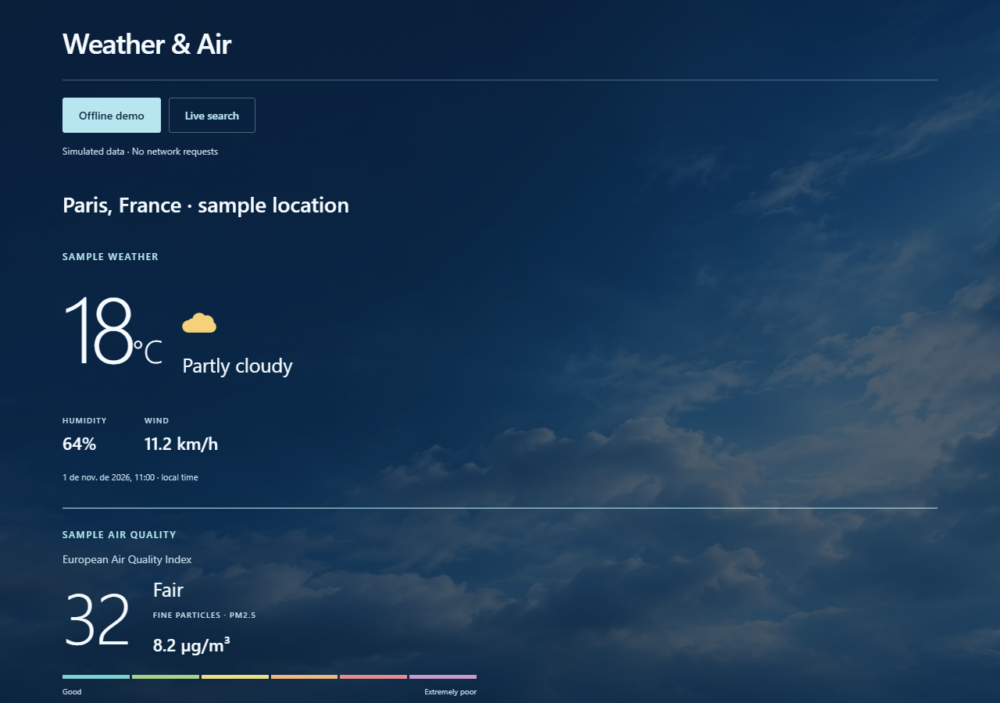
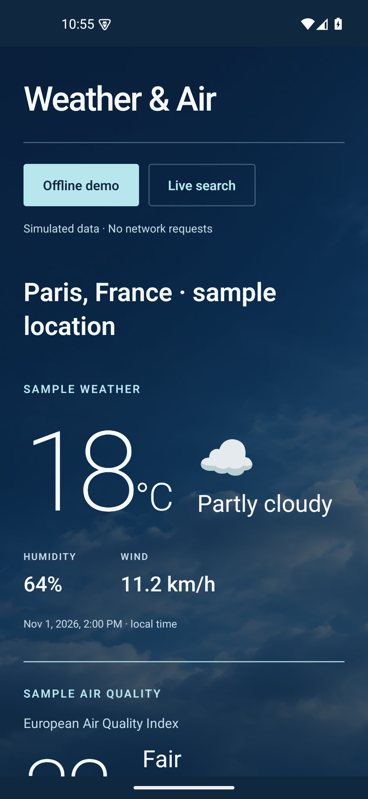

# Weather & Air

Search an address or place, choose the matching location and see weather plus air quality together. Built with React Native, TypeScript and Expo, with a clearly labeled offline demo and a keyless live mode.





This is a refreshed portfolio edition of an earlier technical exercise. The current implementation, demo data and interface were revised in 2026. It is a local learning/demo application; deployment, accounts and production operations are outside its scope.

The blue sky background is generated decorative artwork bundled locally in `assets/sky.webp`. It is illustrative, not a live camera or forecast image.

## Run on the web

Requires Node.js 22.13+ (tested with 24.22.2) and npm. This edition uses Expo SDK 58 and its compatible React/React Native packages.

```sh
npm ci
npm run web
```

Open the local URL printed by Expo. **Offline demo** starts with fictional sample conditions for Paris and makes no provider requests. Its timestamp is fixed to November 1, 2026; it is not current weather.

## Run on Android

```sh
npm run android
```

This generates the Android project from `app.json`, builds a development APK and starts Metro. Use a running Android emulator or attached device. SDK 58 requires the matching Android build tools/platform and NDK; the verified Windows setup uses JDK 17, Android platform 37.0, build tools 37.0.0 and NDK 27.1.12297006. Native folders are generated and excluded from Git. The included `withShortNativePaths` config plugin enables CMake object-path hashing for reproducible Windows native builds and explicitly selects developer support from the application’s build variant. On Windows, use a short checkout path (for example `C:/src/weather-and-air`) because native CMake dependency paths can exceed Windows tool limits in deeply nested folders.

For iOS, Expo can generate a runner on macOS; iOS has not been built or tested here. No cloud build or Expo account is needed for local Android/web use.

## Try live mode

1. Select **Live search**, enter `Eiffel Tower, Paris` and choose **Find location**.
2. Choose the result you mean. Coordinates are never inferred from the first result without your selection.
3. Refresh conditions, try an invalid search, then return to **Offline demo**.

Location search uses [Photon](https://photon.komoot.io/) with [OpenStreetMap](https://www.openstreetmap.org/copyright) data. Weather uses [Open-Meteo](https://open-meteo.com/en/docs), and air quality uses its [CAMS-backed air quality API](https://open-meteo.com/en/docs/air-quality-api). No API keys are embedded or required. These public endpoints are appropriate for a modest noncommercial demo; their availability and usage limits remain provider-controlled. Review their terms before a different deployment model.

Each live search sends the entered text to Photon. Selecting a result sends its coordinates to the weather and air quality providers. The app explains this before searching; it does not request device location, persist addresses or send analytics. Use a public landmark when demonstrating it.

## How it works

`query → candidate places → explicit selection → parallel weather + air quality requests → independent weather and air sections`

- `src/repositories.ts`: encoded URLs, payload validation, abort/timeouts, models and data mapping.
- `App.tsx`: interaction state, request cancellation, explicit mode/location changes and stale-result guards.
- `src/components.tsx`: weather/air cards and controls.
- `src/styles.ts`: responsive shared visual styles.

Requests time out after 12 seconds. A new request or mode change cancels the previous one; late responses cannot overwrite the selected view. Weather and air quality fail independently so a healthy provider’s result remains useful. Missing values show unavailable information rather than fabricated zero readings. Cancellation and retry are explicit controls.

Temperatures are °C, wind is km/h and PM2.5 is µg/m³. **European AQI** bands are 0–20 Good, >20–40 Fair, >40–60 Moderate, >60–80 Poor, >80–100 Very poor and >100 Extremely poor, following the selected provider’s documented scale. Timestamps are provider model times interpreted as UTC and displayed in the viewer’s local time. Model estimates are not a street-level sensor reading.

## Checks

```sh
npm run check
npm run lint
npm test
npm run format:check
npm run build:web
npx expo-doctor
npm audit
```

Tests cover address encoding, malformed results, provider independence, cancellation, missing values and AQI boundaries. Browser validation includes actual Photon/Open-Meteo requests, mode changes, failed input and narrow layouts. Android validation uses the installed app. `dist` is the web export; use a local static server to preview it.

The dependency overrides for `glob` and `minimatch` select patched versions used by Expo tooling. Typecheck, lint, export, doctor and native build verify the resulting dependency graph; retain the lockfile when installing.

Weather and CAMS data require attribution: the app links the providers directly. Open-Meteo data is offered under [CC BY 4.0](https://creativecommons.org/licenses/by/4.0/); OpenStreetMap data has its own attribution and [ODbL](https://www.openstreetmap.org/copyright) terms. Third-party code retains its licenses. A distribution license for this project has not been selected.
